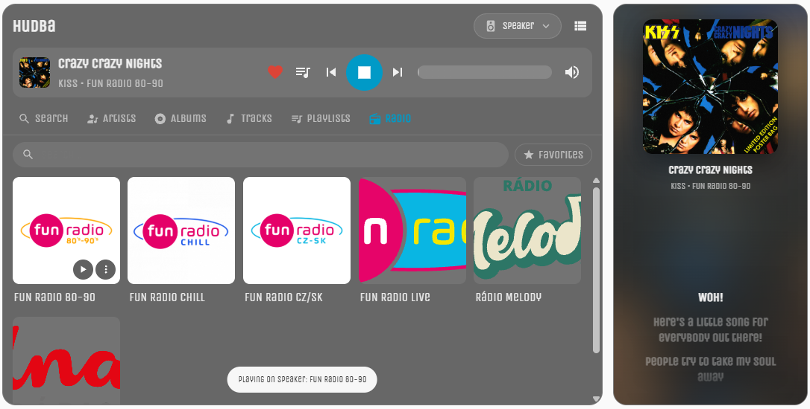
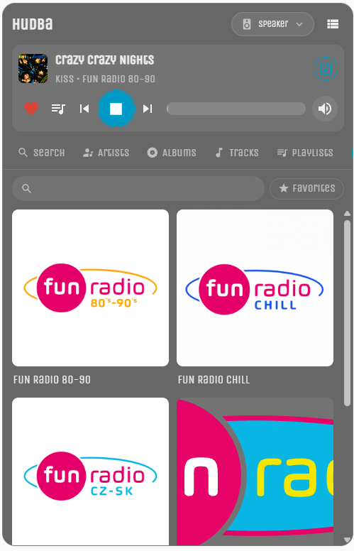

# Music Assistant Player Card

A custom Lovelace card for [Home Assistant](https://www.home-assistant.io/) that lets you browse and play everything in your [Music Assistant](https://music-assistant.io/) library, on any player, from a single card.

Designed for wall tablets (e.g. Kiosk Satellite), desktop dashboards and the Home Assistant phone app.

<p>
  
  
</p>

## Features

- Browse and search players, radio, artists, albums, tracks, playlists, podcasts and audiobooks
- Play on any Music Assistant player (player picker shown as a centred bubble)
- Now-playing bar: previous, stop/play, next, shuffle (hidden for radio), volume slider, mute and a thin seekable progress bar
- Side card with album art and scrolling, time-synced lyrics (via [LRCLIB](https://lrclib.net)); it only appears while something plays, and its space is reserved so the main card never moves
- Mobile layout: compact card, album art and lyrics open as a bottom sheet on demand (swipe down to close)
- Add/remove favorites and add/remove tracks to your own Music Assistant playlists
- Inline (dashboard) mode or button + dialog mode
- Full visual editor: colours, opacity, font, corner radius, text sizes, button sizes, slider and progress sizes, fixed height and width
- Works in panel views and inside `picture-elements` (top/left = top-left corner)
- Touch-friendly scrolling with momentum
- Translations in an external file (English, Slovak, Czech, German included); language follows Home Assistant or can be set manually

## Requirements

- Home Assistant with the [Music Assistant integration](https://www.home-assistant.io/integrations/music_assistant/) set up
- Optional, for favorites and playlist editing: a long-lived access token for the Music Assistant server and a `rest_command` (see below)

## Installation

### HACS (custom repository)

1. HACS → three-dot menu → **Custom repositories**
2. Add `https://github.com/filipjurik/music-assistant-player-card`, category **Dashboard** (Plugin)
3. Install **Music Assistant Player Card**
4. Make sure the resource is registered (HACS normally does this):
   - URL: `/hacsfiles/music-assistant-player-card/music-assistant-player-card-loader.js`
   - Type: **JavaScript Module**

### Manual

1. Create `/config/www/community/music-assistant-player-card/` and copy these three files into it:
   - `music-assistant-player-card-loader.js`
   - `music-assistant-player-card.js`
   - `music-assistant-player-card-lang.json`
2. **Settings → Dashboards → ⋮ → Resources → Add resource**
   - URL: `/local/community/music-assistant-player-card/music-assistant-player-card-loader.js`
   - Type: **JavaScript Module**
3. Hard-refresh the browser (or clear the app cache in the mobile app).

> **Why a loader?** The loader checks the card file's `ETag`/`Last-Modified` and imports it with a matching cache-busting query string. You never need to add or change `?v=` in the resource URL after an update. All three files must stay in the same folder.

## Usage

Add a card in the UI editor (**Music Assistant Player Card**) or in YAML:

```yaml
type: custom:music-assistant-browser-card
entity: media_player.living_room
mode: inline
tabs: [search, artist, album, track, playlist, radio]
default_tab: radio
```

### Panel (single-card) views and picture-elements

In a panel view the card must be the only card. Put `style` inside the card's own config, not as a separate list item. Inside `picture-elements`, the card's `top`/`left` refer to its top-left corner by default (`anchor: top-left`).

```yaml
type: picture-elements
elements:
  - type: custom:music-assistant-browser-card
    entity: media_player.living_room
    anchor: top-left
    style:
      top: 0px
      left: 0px
```

## Configuration

All options are available in the visual editor.

| Option | Default | Description |
|---|---|---|
| `entity` | – | Default player |
| `name` | – | Card title |
| `mode` | `inline` | `inline` (in the dashboard) or `button` (opens a dialog) |
| `icon` | – | Button icon (button mode) |
| `layout` | `auto` | `auto` (mobile layout below 600 px), `desktop`, `mobile` |
| `language` | `auto` | `auto` (Home Assistant language), `en`, `sk`, `cs`, `de`, … |
| `lang_url` | next to the card | URL of a custom language file |
| `tabs` | all | Visible tabs: `search`, `artist`, `album`, `track`, `playlist`, `radio`, `podcast`, `audiobook` |
| `default_tab` | first tab | Tab shown first |
| `players` | all | Limit the player list |
| `show_all_players` | `false` | Also list players outside Music Assistant |
| `page_size` | `60` | Items per page |
| `config_entry_id` | auto | Music Assistant config entry (only if not detected) |
| `height` | screen height | Fixed height (`500px`, `80vh`; a number = px) |
| `height_mobile` | same as `height` | Fixed height in the mobile layout |
| `width` | `100%` | Total width including the side card |
| `align` | `left` | Alignment when narrower than the dashboard |
| `anchor` | `top-left` | Position reference in `picture-elements` (`top-left` or `center`) |
| `border_radius` | – | Corner radius (px) |
| `background_color` | `[40,40,40]` | Background RGB |
| `background_opacity` | `0.6` | 0 = transparent, 1 = solid |
| `text_color` | `[255,255,255]` | Text RGB |
| `font_family` | `Unica` | Font family |
| `font_url` | – | Optional font file URL |
| `font_size_title` | – | Title size (px) |
| `font_size_now_playing` | – | "Nothing is playing" / current track line (px) |
| `font_size_selectors` | – | Tabs, search field and filters (px) |
| `font_size_items` | – | Result tile title (px) |
| `font_size_items_sub` | – | Result tile subtitle (px) |
| `button_size` | – | Previous / Next / Shuffle buttons (px) |
| `button_size_main` | – | Play / Stop button (px) |
| `volume_width` | – | Volume slider width (px) |
| `volume_height` | – | Volume slider height (px) |
| `progress_height` | `5` | Progress bar height (px) |
| `side_card` | `true` | Show album art and lyrics beside the card |
| `side_card_width` | `360` | Side card width (px) |
| `lyrics` | `true` | Show lyrics |
| `lyrics_offset` | `0` | Lyrics offset in seconds (positive = earlier) |
| `ma_api_service` | `ma_api` | `rest_command` used for favorites and playlists |
| `show_version` | `false` | Show card version next to the title |

## Favorites and playlists (optional)

Favorites and playlist editing use the Music Assistant server API through a Home Assistant `rest_command`, so the token never appears in your dashboard. Without it the card works normally but those buttons are hidden.

1. In Music Assistant, create a long-lived access token (user profile / settings).
2. Add it to `secrets.yaml`:

   ```yaml
   ma_token: "Bearer YOUR_LONG_LIVED_TOKEN"
   ```

3. Add to `configuration.yaml` (adjust host and port; the default Music Assistant port is `8095`):

   ```yaml
   rest_command:
     ma_api:
       url: "http://MUSIC_ASSISTANT_HOST:8095/api"
       method: post
       headers:
         Authorization: !secret ma_token
         Content-Type: application/json
       payload: '{"command": "{{ command }}", "args": {{ args }}}'
       content_type: application/json
   ```

4. Restart Home Assistant (a restart is needed after editing `secrets.yaml` or `rest_command`).

If you name the service differently, set `ma_api_service` in the card.

> **Upgrading from an earlier build?** The files were renamed to `music-assistant-player-card*`. Update the resource URL accordingly. The card type stays `custom:music-assistant-browser-card`, so existing dashboards keep working.

## Languages

English is built in. Other languages come from `music-assistant-player-card-lang.json`. To add one, add a new language object (copy the `en` block, translate the values) and set `language: xx`, or send a pull request.

## Troubleshooting

- **"Custom element doesn't exist" / "Configuration error"** – the resource is not loaded. Check the resource URL (loader file, type *JavaScript Module*), that all three files are in the same folder, and that `music-assistant-player-card.js` starts with `/*! Music Assistant Player Card v…` and is about 120 kB (a corrupted upload is the usual cause). Then clear the browser/app cache.
- **Changes not visible after an update** – hard-refresh; in the iPhone app use *Settings → Companion App → Debugging → Reset frontend cache*.
- **401 from favorites/playlists** – the token is wrong or the `Authorization` header is missing the `Bearer ` prefix.
- **Swiping the tab selectors changes the dashboard view** – this comes from the [Swipe Navigation](https://github.com/zanna-37/hass-swipe-navigation) integration. Exclude the view with `swipe_nav: skip_tabs: <view index>` in the dashboard's raw configuration.
- **"A panel can only show 1 card"** – put `style` inside the card config instead of adding it as a separate list item.

## Support

If you find this card useful, you can support its development.

[](https://paypal.me/fijur76)

## License

[MIT](LICENSE)
